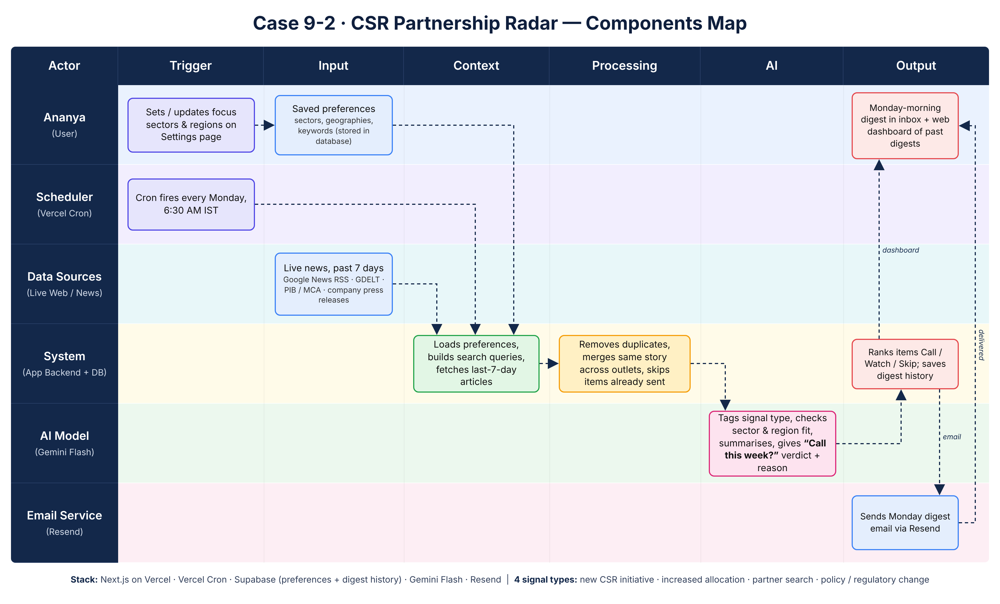

# CSR Partnership Radar

A weekly CSR intelligence digest for Ananya, Head of Corporate Partnerships at a Pune-based education NGO. Every Monday at 6:30 AM IST it collects the past week's CSR news, removes duplicates and anything already sent, asks Gemini Flash to classify and rate each item, saves the digest and emails it. The same digest is on a small web dashboard.

Every item answers one question: **"Is this worth a call this week?"**

Signal types: `new_initiative`, `increased_allocation`, `partner_search`, `policy_change`.

- Live app: https://csr-partnership-radar-eight.vercel.app
- Components map: [docs/components-map.png](docs/components-map.png)



## Architecture

```
Vercel Cron (0 1 * * 1 = Mon 06:30 IST) ─┐
Settings page "Run digest now" ──────────┴─> runDigest(trigger)
```

`lib/pipeline/`, one file per step:

| Step | What it does |
| --- | --- |
| `loadSettings` | Reads the single `settings` row (sectors, regions, extra keywords, recipient). |
| `buildQueries` | Sectors × CSR terms, plus partner-search, allocation and policy queries, regions and extra keywords. Hard cap of 12 queries, each limited with `when:7d`. |
| `fetchSources` | Fetches every query in parallel (8 s timeout each), normalises to `{title, url, source, publishedAt, snippet}`, keeps only the last 7 days. Failures are logged and recorded in `source_status`; nothing is ever filled in. |
| `dedupe` | Normalises URLs (strips tracking params), merges stories whose titles have token Jaccard ≥ 0.6 (keeps the earliest), drops URLs already stored in earlier digests (indexed `url_hash`), caps at 60. |
| `analyse` | Gemini Flash via `@google/genai`, batches of 15, one at a time, structured JSON output (`responseSchema`) validated with Zod. Invalid output is retried once, then that batch is marked failed. Stops early before the 60 s function limit rather than losing the run. |
| `rank` | call > watch > skip, then priority (1 = most urgent), then most recent. |
| `save` | Writes the digest and its items to Supabase. |
| `sendEmail` | Plain inline-styled HTML via Resend: Call this week, Watch, Policy & regulation, skipped count + dashboard link. |

Routes:

- `GET /api/cron/digest`: requires `Authorization: Bearer $CRON_SECRET` (sent by Vercel Cron).
- `POST /api/digest/run`: manual run, requires the `x-admin-passcode` header.
- `GET /api/settings` (open), `PUT /api/settings` (passcode, Zod-validated).

Pages: `/` (latest digest), `/digests` and `/digests/[id]` (history), `/settings`.

Stack: Next.js 16 (App Router) + TypeScript (strict) + Tailwind CSS, Supabase Postgres, Gemini Flash, Resend, Vercel Cron, Zod. All keys stay server-side.

## Setup

```bash
npm install
cp .env.example .env.local   # fill in the values below
```

Run `supabase/schema.sql` once in the Supabase SQL editor. It creates `settings` (seeded with the default sectors and regions), `digests` and `digest_items`, with row-level security on so only the service role can read or write them. Set the recipient email in **Settings**.

```bash
npm run dev     # http://localhost:3000
```

## Environment variables

| Name | Purpose |
| --- | --- |
| `GEMINI_API_KEY` | Google AI Studio key. |
| `GEMINI_MODEL` | Gemini Flash model name. Code default is `gemini-2.5-flash`; this deployment uses `gemini-3.8-flash` (see limitations). |
| `SUPABASE_URL` | Supabase project URL. |
| `SUPABASE_SERVICE_ROLE_KEY` | Service role key, server-side only. |
| `RESEND_API_KEY` | Resend API key. |
| `DIGEST_FROM_EMAIL` | Sender, e.g. `onboarding@resend.dev`. |
| `CRON_SECRET` | Vercel Cron sends it as `Authorization: Bearer <CRON_SECRET>`. |
| `ADMIN_PASSCODE` | Protects saving settings and "Run digest now". |
| `APP_URL` | Public URL, used for the dashboard link in the email. |

## Tests and smoke run

```bash
npm test        # Vitest: dedupe, 7-day filter, Gemini Zod parsing, cron auth, buildQueries
npm run smoke   # real pipeline, dry run: live sources + Gemini, no DB write, no email
npm run lint
npm run build
```

`npm run smoke` prints per-source counts, the count after dedup and the first three analysed items.

## Deploy

```bash
vercel link
vercel env add <NAME> production    # for each variable above
vercel deploy --prod
```

`vercel.json` registers the cron `0 1 * * 1` for `/api/cron/digest`. Generate the first digest from **Settings → Run digest now** (or `curl -X POST -H "x-admin-passcode: …" $APP_URL/api/digest/run`).

## Known limitations

- **Email uses the Resend test sender** (`onboarding@resend.dev`), which only delivers to the email address that owns the Resend account. Sending to anyone else needs a verified domain in Resend.
- **GDELT was dropped.** During the build every request to the GDELT DOC 2.0 API returned `HTTP 429` ("Please limit requests to one every 5 seconds"), including single requests after long cool-downs, so its response could not be verified and it is not used.
- **PIB RSS was dropped.** The only PIB feed that returned items (`RssMain.aspx?ModId=6&Lang=1&Regid=3`) served Hindi titles with no `pubDate` or description, so the 7-day filter cannot be applied. Policy news is covered by Google News queries for CSR rules, Schedule VII, CSR amendments and MCA.
- **Google News links are not resolved** to the publisher URL. They redirect through a JavaScript page, so the original `news.google.com` link is kept (tracking params stripped).
- **Snippets are thin.** The Google News RSS description only repeats the headline, so Gemini mostly works from the title, source and date. The prompt tells it not to add facts and to return `null` for unknown companies.
- **`gemini-2.5-flash` is not available to new API keys.** The API answered "no longer available to new users", so `GEMINI_MODEL` is set to `gemini-3.8-flash` (still Gemini Flash).
- **Run time.** A full run takes about 45 s against the 60 s limit. If Gemini is slow, the remaining batches are skipped, counted as "not analysed" and the digest is marked `partial`; those URLs are not stored, so they are picked up again next week.
